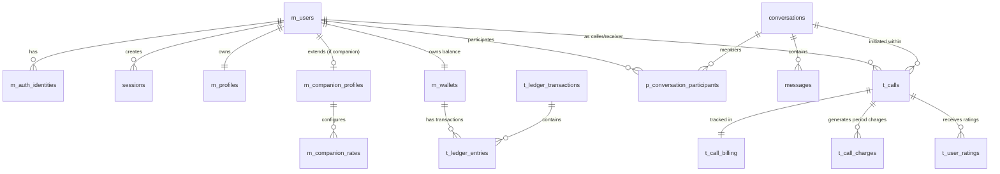

 Accompany Database Architecture & Schema Reference

**Database Schema:** `acc`  
**Database Engine:** PostgreSQL 16+ (Extensions: `uuid-ossp`, `cube`, `earthdistance`)  
**Design Pattern:** Modular relational architecture, double-entry financial ledger, strict foreign key constraints, and state-machine integrity checks.

---

## 1. System Architecture Overview

The database is structured around six core business domains:

### Table Naming Conventions
* **`m_*` (Master/Entity Tables):** Core static or stateful entities (e.g., users, profiles, wallets, rates).
* **`t_*` (Transaction/Event Tables):** High-frequency event streams, logs, calls, and financial records.
* **`p_*` (Pivot/Junction Tables):** Many-to-many relationship mappings or join tables (e.g., participants, interests).
* Plain names (e.g. `conversations`, `messages`, `sessions`): Primary domain tables.

---

## 2. Identity, Authentication & Sessions

### `acc.m_users`
* **Purpose:** The root user account entity in the system. Every authenticated person or companion traces back to this primary ID.
* **Relationships:**
  * Referenced by nearly all tables via `user_id` (`ON DELETE RESTRICT`).
* **Columns:**
  | Column | Type | Constraints | Description |
  | :--- | :--- | :--- | :--- |
  | `id` | `UUID` | `PK`, default `gen_random_uuid()` | Primary unique identifier for the user. |
  | `status` | `TEXT` | `NOT NULL`, default `'active'` | Account status: `'active'`, `'suspended'`, `'deactivated'`. |
  | `created_at` | `TIMESTAMPTZ` | `NOT NULL`, default `NOW()` | Timestamp when the user signed up. |
  | `updated_at` | `TIMESTAMPTZ` | `NOT NULL`, default `NOW()` | Timestamp of last record update. |
  | `deleted_at` | `TIMESTAMPTZ` | `NULL` | Soft deletion timestamp. |
  | `last_seen_at` | `TIMESTAMPTZ` | `NULL` | Timestamp of the user's last interaction/login. |

---

### `acc.m_auth_identities`
* **Purpose:** Authentication provider credentials and identifiers (Phone E.164, Email, Google, Apple). Supports linking multiple login methods to one user account.
* **Relationships:**
  * `user_id` $\rightarrow$ `acc.m_users(id)` (`ON DELETE RESTRICT`)
* **Columns:**
  | Column | Type | Constraints | Description |
  | :--- | :--- | :--- | :--- |
  | `id` | `UUID` | `PK` | Unique identity row identifier. |
  | `user_id` | `UUID` | `NOT NULL`, `FK` | The associated user. |
  | `provider` | `TEXT` | `NOT NULL` | Provider type: `'phone'`, `'email'`, `'google'`, `'apple'`. |
  | `provider_subject` | `TEXT` | `NOT NULL` | Unique identifier under that provider (e.g., normalized phone `+919123194132`). |
  | `email` | `TEXT` | `NULL` | Verified email address. |
  | `phone` | `TEXT` | `NULL` | Verified E.164 phone number. |
  | `verified_at` | `TIMESTAMPTZ` | `NULL` | Timestamp when the channel was verified via OTP. |
  | `created_at` | `TIMESTAMPTZ` | `NOT NULL` | Identity creation date. |
  | `updated_at` | `TIMESTAMPTZ` | `NOT NULL` | Identity update date. |

---

### `acc.m_devices`
* **Purpose:** Device tracking across mobile platforms (Android/iOS) for push notifications and multi-device session management.
* **Relationships:**
  * `user_id` $\rightarrow$ `acc.m_users(id)` (`ON DELETE CASCADE`)
* **Columns:**
  | Column | Type | Constraints | Description |
  | :--- | :--- | :--- | :--- |
  | `id` | `UUID` | `PK` | Device record ID. |
  | `user_id` | `UUID` | `NOT NULL`, `FK` | Associated user. |
  | `device_identifier` | `TEXT` | `NOT NULL`, `UNIQUE` | Hardware/app-scoped device UUID. |
  | `platform` | `TEXT` | `NOT NULL` | OS platform: `'ios'`, `'android'`. |
  | `app_version` | `TEXT` | `NULL` | Installed app release version string. |
  | `push_token` | `TEXT` | `NULL` | Push notification token (APNs/FCM). |
  | `last_seen_at` | `TIMESTAMPTZ` | `NOT NULL` | Last network contact timestamp. |
  | `created_at` | `TIMESTAMPTZ` | `NOT NULL` | Device first registration. |
  | `updated_at` | `TIMESTAMPTZ` | `NOT NULL` | Last update. |

---

### `acc.sessions`
* **Purpose:** Server-side token refresh tracking for JWT rotation, revoking access tokens, and managing active logins.
* **Relationships:**
  * `user_id` $\rightarrow$ `acc.m_users(id)` (`ON DELETE CASCADE`)
  * `device_id` $\rightarrow$ `acc.m_devices(id)` (`ON DELETE SET NULL`)
* **Columns:**
  | Column | Type | Constraints | Description |
  | :--- | :--- | :--- | :--- |
  | `id` | `UUID` | `PK` | Session ID (matches `sid` claim in JWT access token). |
  | `user_id` | `UUID` | `NOT NULL`, `FK` | User owning the session. |
  | `refresh_token_hash` | `TEXT` | `NOT NULL`, `UNIQUE` | SHA-256 HMAC hash of the refresh token. |
  | `device_id` | `UUID` | `NULL`, `FK` | Originating device. |
  | `platform` | `TEXT` | `NULL` | Client platform. |
  | `expires_at` | `TIMESTAMPTZ` | `NOT NULL` | Refresh token expiry timestamp. |
  | `revoked_at` | `TIMESTAMPTZ` | `NULL` | Populated when user logs out or session is revoked. |
  | `last_used_at` | `TIMESTAMPTZ` | `NOT NULL` | Last time a refresh token was exchanged. |

---

### `acc.otp_verifications`
* **Purpose:** Stores one-time password hashes, rate limiting attempts, and verification state for SMS/Email logins.
* **Relationships:** Standalone lookup table queried by destination & channel.
* **Columns:**
  | Column | Type | Constraints | Description |
  | :--- | :--- | :--- | :--- |
  | `id` | `UUID` | `PK` | Unique verification request ID. |
  | `destination` | `TEXT` | `NOT NULL` | Phone number or email. |
  | `channel` | `TEXT` | `NOT NULL` | Channel: `'phone'`, `'email'`, `'sms'`, `'whatsapp'`. |
  | `otp_hash` | `TEXT` | `NOT NULL` | HMAC-SHA256 hash of the generated 6-digit OTP code. |
  | `expires_at` | `TIMESTAMPTZ` | `NOT NULL` | Expiry threshold (typically 5 minutes). |
  | `attempt_count` | `INT` | `NOT NULL`, default `0` | Failed attempts counter (max 5). |
  | `verified_at` | `TIMESTAMPTZ` | `NULL` | Timestamp when OTP was successfully validated. |
  | `purpose` | `TEXT` | `NOT NULL`, default `'otp'` | Purpose of OTP: `'otp'`, `'auth'`, `'password_reset'`. |
  | `status` | `TEXT` | `NOT NULL`, default `'pending'` | Lifecycle state: `'pending'`, `'verified'`, `'locked'`, `'expired'`. |

---

### `acc.presence`
* **Purpose:** Ultra-lightweight table tracking live online presence and heartbeat from WebSocket connections.
* **Relationships:**
  * `user_id` $\rightarrow$ `acc.m_users(id)` (`ON DELETE CASCADE`)
* **Columns:**
  | Column | Type | Constraints | Description |
  | :--- | :--- | :--- | :--- |
  | `user_id` | `UUID` | `PK`, `FK` | The user ID. |
  | `last_seen_at` | `TIMESTAMPTZ` | `NOT NULL`, default `NOW()` | Timestamp updated on WebSocket ping/activity. Indexed for rapid discovery queries. |

---

## 3. Profiles, Onboarding, Interests & Companion Setup

### `acc.m_profiles`
* **Purpose:** Public profiles, bios, geolocation discovery, account intent, and onboarding progress.
* **Relationships:**
  * `user_id` $\rightarrow$ `acc.m_users(id)` (`ON DELETE RESTRICT`)
  * `avatar_media_id` $\rightarrow$ `acc.m_profile_media(id)`
* **Columns:**
  | Column | Type | Constraints | Description |
  | :--- | :--- | :--- | :--- |
  | `user_id` | `UUID` | `PK`, `FK` | User ID. |
  | `display_name` | `TEXT` | `NOT NULL` | Profile nickname or screen name. |
  | `birth_date` | `DATE` | `NULL` | User birth date. |
  | `gender` | `TEXT` | `NULL` | Gender: `'male'`, `'female'`, `'non_binary'`, `'other'`. |
  | `bio` | `TEXT` | `NULL` | Short user bio. |
  | `avatar_media_id` | `UUID` | `NULL`, `FK` | Primary profile picture media ID. |
  | `onboarding_step` | `TEXT` | `NOT NULL`, default `'intent'` | Current step: `'intent'`, `'basics'`, `'photo'`, `'interests'`, `'location'`, `'role'`, `'rates'`, `'completed'`. |
  | `profile_status` | `TEXT` | `NOT NULL`, default `'incomplete'` | Status: `'incomplete'`, `'active'`, `'hidden'`, `'suspended'`. |
  | `latitude` / `longitude` | `DOUBLE PRECISION` | `NULL` | Earth coordinates for geolocation queries (`cube` + `earthdistance` index). |
  | `location_discovery` | `BOOLEAN` | `NOT NULL`, default `TRUE` | Whether the user allows nearby radius discovery. |
  | `account_intent` | `TEXT` | `NOT NULL`, default `'anonymous'` | `'anonymous'` (regular caller) or `'provider'` (companion earning money). |
  | `support_role` | `TEXT` | `NULL` | Provider specialty: `'friendly'`, `'astrologer'`, `'counselor'`, `'expert'`. |
  | `verification_status` | `TEXT` | `NOT NULL`, default `'none'` | Professional verification: `'none'`, `'pending'`, `'approved'`, `'rejected'`. |
  | `expert_subject` | `TEXT` | `NULL` | Subject specialization (required if role is `'expert'`). |
  | `deleted_at` | `TIMESTAMPTZ` | `NULL` | Soft delete marker. |

---

### `acc.m_profile_media`
* **Purpose:** Media files, profile photo galleries, and moderation flags.
* **Relationships:**
  * `user_id` $\rightarrow$ `acc.m_users(id)` (`ON DELETE CASCADE`)
* **Columns:**
  | Column | Type | Constraints | Description |
  | :--- | :--- | :--- | :--- |
  | `id` | `UUID` | `PK` | Unique media item identifier. |
  | `user_id` | `UUID` | `NOT NULL`, `FK` | Profile owner. |
  | `media_type` | `TEXT` | `NOT NULL` | Media type: `'image'`, `'audio'`, `'video'`. |
  | `storage_url` | `TEXT` | `NOT NULL` | S3 / CDN URL of the media file. |
  | `display_order` | `INT` | `NOT NULL`, default `0` | Sorting order in profile photo carousel. |
  | `status` | `TEXT` | `NOT NULL`, default `'uploaded'` | Lifecycle state: `'uploaded'`, `'ready'`, `'failed'`. |
  | `moderation_status` | `TEXT` | `NOT NULL`, default `'approved'` | Safety moderation: `'pending'`, `'approved'`, `'flagged'`, `'rejected'`. |

---

### `acc.m_interests` & `acc.p_user_interests`
* **Purpose:** Taxonomy of interests/hobbies and junction association to users for discovery matchmaking.
* **Relationships:**
  * `acc.p_user_interests.user_id` $\rightarrow$ `acc.m_users(id)` (`ON DELETE CASCADE`)
  * `acc.p_user_interests.interest_id` $\rightarrow$ `acc.m_interests(id)` (`ON DELETE CASCADE`)
* **Columns (`acc.m_interests`):**
  * `id` (`UUID PK`), `category` (`TEXT`), `name` (`TEXT UNIQUE`), `display_order` (`INT`).
* **Columns (`acc.p_user_interests`):**
  * `user_id` (`UUID FK`), `interest_id` (`UUID FK`), `created_at` (`TIMESTAMPTZ`). Composite PK: `(user_id, interest_id)`.

---

### `acc.m_companion_profiles`
* **Purpose:** Companion-specific configuration for providers accepting calls (audio/video intros, spoken languages).
* **Relationships:**
  * `user_id` $\rightarrow$ `acc.m_users(id)` (`ON DELETE RESTRICT`)
* **Columns:**
  | Column | Type | Constraints | Description |
  | :--- | :--- | :--- | :--- |
  | `user_id` | `UUID` | `PK`, `FK` | Companion's user ID. |
  | `headline` | `TEXT` | `NULL` | Catchy header for discovery listing. |
  | `about_me` | `TEXT` | `NULL` | Detailed introduction and background. |
  | `languages_spoken` | `TEXT[]` | `NOT NULL`, default `'{}'` | Array of languages supported (e.g., `{'en', 'hi'}`). |
  | `voice_intro_media_id`| `UUID` | `NULL`, `FK` | Voice introduction sample media. |
  | `video_intro_media_id`| `UUID` | `NULL`, `FK` | Video introduction sample media. |
  | `is_published` | `BOOLEAN` | `NOT NULL`, default `FALSE` | Toggle to appear in companion search/discovery. |

---

### `acc.m_companion_rates`
* **Purpose:** The pricing configured by companions. **Every caller must pay this per-minute or per-message rate.**
* **Relationships:**
  * `companion_user_id` $\rightarrow$ `acc.m_companion_profiles(user_id)` (`ON DELETE RESTRICT`)
* **Columns:**
  | Column | Type | Constraints | Description |
  | :--- | :--- | :--- | :--- |
  | `id` | `UUID` | `PK` | Unique rate record ID. |
  | `companion_user_id` | `UUID` | `NOT NULL`, `FK` | The companion setting the rate. |
  | `communication_type`| `TEXT` | `NOT NULL` | `'message'`, `'voice_call'`, `'video_call'`. |
  | `rate_type` | `TEXT` | `NOT NULL` | `'per_message'`, `'per_minute'`. |
  | `rate_coins` | `BIGINT` | `NOT NULL`, $\ge 0$ | Coin cost per minute or message. |
  | `is_active` | `BOOLEAN` | `NOT NULL`, default `TRUE` | Whether this rate is currently active. |

---

### `acc.m_support_credentials`
* **Purpose:** Stores verification certificates and degrees for Astrologers, Counselors, and Experts.
* **Relationships:**
  * `user_id` $\rightarrow$ `acc.m_users(id)` (`ON DELETE CASCADE`)
* **Columns:**
  * `id` (`UUID PK`), `user_id` (`UUID FK`), `role` (`TEXT`), `document_type` (`TEXT`), `document_url` (`TEXT`), `status` (`'pending'|'approved'|'rejected'`), `submitted_at`, `reviewed_at`, `reviewer_notes`.

---

## 4. Conversations, Messaging & Social

### `acc.conversations`
* **Purpose:** 1-on-1 chat rooms and request lifecycles between users.
* **Relationships:**
  * `created_by` $\rightarrow$ `acc.m_users(id)` (`ON DELETE RESTRICT`)
* **Columns:**
  | Column | Type | Constraints | Description |
  | :--- | :--- | :--- | :--- |
  | `id` | `UUID` | `PK` | Unique conversation ID. |
  | `created_by` | `UUID` | `NOT NULL`, `FK` | User who sent the initial request. |
  | `status` | `TEXT` | `NOT NULL`, default `'pending'` | State: `'pending'`, `'active'`, `'ended'`, `'blocked'`, `'rejected'`. |
  | `created_at` / `updated_at` | `TIMESTAMPTZ` | `NOT NULL` | Timestamps. |

---

### `acc.p_conversation_participants`
* **Purpose:** Maps which users are members of a conversation, tracking unread timestamps and who left.
* **Relationships:**
  * `conversation_id` $\rightarrow$ `acc.conversations(id)` (`ON DELETE CASCADE`)
  * `user_id` $\rightarrow$ `acc.m_users(id)` (`ON DELETE RESTRICT`)
* **Columns:**
  | Column | Type | Constraints | Description |
  | :--- | :--- | :--- | :--- |
  | `conversation_id` | `UUID` | `NOT NULL`, `FK` | Conversation ID. |
  | `user_id` | `UUID` | `NOT NULL`, `FK` | Participant user ID. |
  | `role` | `TEXT` | `NOT NULL`, default `'member'` | Role in chat (`'member'`, `'admin'`). |
  | `joined_at` | `TIMESTAMPTZ` | `NOT NULL` | Time joined. |
  | `left_at` | `TIMESTAMPTZ` | `NULL` | Time user left/deleted conversation. |
  | `last_read_at` | `TIMESTAMPTZ` | `NULL` | Read receipt timestamp. |

---

### `acc.messages`
* **Purpose:** Real-time messages sent within a conversation.
* **Relationships:**
  * `conversation_id` $\rightarrow$ `acc.conversations(id)` (`ON DELETE CASCADE`)
  * `sender_id` $\rightarrow$ `acc.m_users(id)` (`ON DELETE RESTRICT`)
* **Columns:**
  | Column | Type | Constraints | Description |
  | :--- | :--- | :--- | :--- |
  | `id` | `UUID` | `PK` | Unique message ID. |
  | `conversation_id` | `UUID` | `NOT NULL`, `FK` | Parent conversation. |
  | `sender_id` | `UUID` | `NOT NULL`, `FK` | Message author. |
  | `message_type` | `TEXT` | `NOT NULL`, default `'text'` | Type: `'text'`, `'image'`, `'gif'`, `'system'`. |
  | `content` | `TEXT` | `NOT NULL` | Message body. |
  | `media_url` | `TEXT` | `NULL` | Optional media/GIF attachment URL. |
  | `client_message_id` | `TEXT` | `NULL` | Idempotency key from mobile app for optimistic updates. |
  | `created_at` / `deleted_at`| `TIMESTAMPTZ` | — | Creation and soft-deletion timestamps. |

---

### `acc.blocks`
* **Purpose:** User blocking relationships. Prevents calls, messages, and presence discovery between both parties.
* **Relationships:**
  * `user_id` $\rightarrow$ `acc.m_users(id)` (the blocker)
  * `blocked_user_id` $\rightarrow$ `acc.m_users(id)` (the blocked user)

---

## 5. Live Audio & Video Calling (LiveKit Integration)

### `acc.t_calls`
* **Purpose:** The core live call record. Tracks LiveKit room name, rate snapshot at start of call, duration, and status transitions.
* **Unique Constraints:**
  * `uq_t_calls_caller_active`: Enforces max **1 active call** per caller (`RINGING`, `ACCEPTED`, `CONNECTING`, `CONNECTED`).
  * `uq_t_calls_receiver_active`: Enforces max **1 active call** per receiver.
* **Relationships:**
  * `caller_id` $\rightarrow$ `acc.m_users(id)` (`ON DELETE RESTRICT`)
  * `receiver_id` $\rightarrow$ `acc.m_users(id)` (`ON DELETE RESTRICT`)
  * `conversation_id` $\rightarrow$ `acc.conversations(id)` (`NULLABLE`)
* **Columns:**
  | Column | Type | Constraints | Description |
  | :--- | :--- | :--- | :--- |
  | `id` | `UUID` | `PK` | Call ID. |
  | `conversation_id` | `UUID` | `NULL`, `FK` | Conversation where call originated. |
  | `caller_id` | `UUID` | `NOT NULL`, `FK` | User initiating and paying for the call. |
  | `receiver_id` | `UUID` | `NOT NULL`, `FK` | Companion receiving the call. |
  | `call_type` | `TEXT` | `NOT NULL` | `'AUDIO'` or `'VIDEO'`. |
  | `status` | `TEXT` | `NOT NULL`, default `'RINGING'` | State: `'RINGING'`, `'ACCEPTED'`, `'CONNECTING'`, `'CONNECTED'`, `'ENDED'`, `'DECLINED'`, `'MISSED'`, `'CANCELLED'`, `'FAILED'`. |
  | `rate_snapshot` | `BIGINT` | `NOT NULL`, $\ge 0$ | Companion's rate (coins/minute) locked when call was initiated. |
  | `room_name` | `TEXT` | `NOT NULL`, `UNIQUE` | Unique LiveKit room identifier (e.g. `call_<id>`). |
  | `started_at` | `TIMESTAMPTZ` | `NOT NULL` | Time ringing started. |
  | `connected_at` | `TIMESTAMPTZ` | `NULL` | Time participants connected in LiveKit. |
  | `ended_at` | `TIMESTAMPTZ` | `NULL` | Time call ended. |
  | `duration_seconds` | `BIGINT` | `NOT NULL`, default `0` | Total connected duration. |
  | `end_reason` | `TEXT` | `NULL` | Reason: `'hangup'`, `'timeout'`, `'declined'`, `'insufficient_balance'`, `'disconnect'`. |

---

### `acc.t_call_billing`
* **Purpose:** Real-time billing state machine for an ongoing or ended call. Tracks charged vs outstanding coins.
* **Relationships:**
  * `call_id` $\rightarrow$ `acc.t_calls(id)` (`ON DELETE RESTRICT`, `PK`)
* **Columns:**
  | Column | Type | Constraints | Description |
  | :--- | :--- | :--- | :--- |
  | `call_id` | `UUID` | `PK`, `FK` | The associated call ID. |
  | `rate` | `BIGINT` | `NOT NULL` | Coins per minute. |
  | `billing_unit` | `TEXT` | `NOT NULL`, default `'minute'` | Billing increment. |
  | `billable_duration`| `BIGINT` | `NOT NULL`, default `0` | Calculated billable seconds. |
  | `total_amount` | `BIGINT` | `NOT NULL`, default `0` | Total coins owed for the full call. |
  | `amount_charged` | `BIGINT` | `NOT NULL`, default `0` | Total coins already deducted from caller's wallet. |
  | `billing_status` | `TEXT` | `NOT NULL`, default `'open'` | `'open'` (active) or `'settled'` (final reconciliation complete). |
  | `last_billed_at` | `TIMESTAMPTZ` | `NULL` | Timestamp of most recent minute reconciliation. |

---

### `acc.t_call_charges`
* **Purpose:** Idempotent per-minute charge slice entries deducted during a call.
* **Relationships:**
  * `call_id` $\rightarrow$ `acc.t_calls(id)` (`ON DELETE RESTRICT`)
* **Columns:**
  | Column | Type | Constraints | Description |
  | :--- | :--- | :--- | :--- |
  | `id` | `UUID` | `PK` | Unique charge record ID. |
  | `call_id` | `UUID` | `NOT NULL`, `FK` | Call ID. |
  | `period` | `INT` | `NOT NULL` | Minute interval index (0, 1, 2...). |
  | `coins` | `BIGINT` | `NOT NULL` | Coins charged for this period slice. |
  | `idempotency_key` | `TEXT` | `NOT NULL`, `UNIQUE` | Unique token ensuring no duplicate minute charges. |

---

### `acc.p_device_tokens`
* **Purpose:** Active push notification device tokens (APNs / FCM) used for sending VoIP incoming call alerts.
* **Relationships:**
  * `user_id` $\rightarrow$ `acc.m_users(id)` (`ON DELETE CASCADE`)
* **Columns:**
  * `id` (`UUID PK`), `user_id` (`UUID FK`), `platform` (`'ios'|'android'`), `token` (`TEXT UNIQUE`), `is_active` (`BOOLEAN`).

---

### `acc.t_call_webhook_events`
* **Purpose:** Deduplication log for incoming LiveKit Webhook events (`participant_joined`, `participant_left`, `room_finished`).
* **Columns:**
  * `id` (`TEXT PK`), `event_type` (`TEXT`), `call_id` (`UUID NULL FK`), `created_at` (`TIMESTAMPTZ`).

---

## 6. Financial Ledger, Wallets & Purchases

### `acc.m_wallets`
* **Purpose:** The user's coin balance account. Enforces non-negative balances and tracks companion earnings vs held coins.
* **Relationships:**
  * `user_id` $\rightarrow$ `acc.m_users(id)` (`ON DELETE RESTRICT`)
  * Unique on `(user_id, currency_type)`.
* **Columns:**
  | Column | Type | Constraints | Description |
  | :--- | :--- | :--- | :--- |
  | `id` | `UUID` | `PK` | Unique wallet identifier. |
  | `user_id` | `UUID` | `NOT NULL`, `FK` | User owning this wallet. |
  | `currency_type` | `TEXT` | `NOT NULL`, `'coins'` | Wallet currency. |
  | `balance` | `BIGINT` | `NOT NULL`, default `0`, $\ge 0$ | Total spendable coin balance. |
  | `held_coins` | `BIGINT` | `NOT NULL`, default `0`, $\ge 0$ | Coins temporarily reserved for pending transactions/withdrawals. |
  | `earned_coins` | `BIGINT` | `NOT NULL`, default `0`, $\le \text{balance}$ | Coins earned as a companion (eligible for cash withdrawal). |
  | `status` | `TEXT` | `NOT NULL`, default `'active'` | `'active'` or `'frozen'`. Only `'active'` wallets can make calls. |
  | `created_at` / `updated_at` | `TIMESTAMPTZ` | `NOT NULL` | Audit timestamps. |

---

### `acc.t_ledger_transactions`
* **Purpose:** The parent transaction header for every financial movement. Groups debit/credit ledger lines.
* **Relationships:**
  * Referenced by `acc.t_ledger_entries(transaction_id)`.
* **Columns:**
  | Column | Type | Constraints | Description |
  | :--- | :--- | :--- | :--- |
  | `id` | `UUID` | `PK` | Unique transaction ID. |
  | `reference_type` | `TEXT` | `NOT NULL` | Source entity type (`'call_charge'`, `'coin_purchase'`, `'withdrawal'`, `'manual_credit'`). |
  | `reference_id` | `UUID` | `NOT NULL` | ID of the source entity (e.g. charge ID or purchase ID). |
  | `transaction_type` | `TEXT` | `NOT NULL` | Type: `'coin_purchase'`, `'voice_call_debit'`, `'voice_call_credit'`, `'video_call_debit'`, `'video_call_credit'`, `'bonus'`, `'withdrawal'`. |
  | `status` | `TEXT` | `NOT NULL` | State: `'pending'`, `'completed'`, `'failed'`, `'reversed'`. |
  | `description` | `TEXT` | `NULL` | Human-readable description (shown in app transaction history). |
  | `created_at` / `completed_at`| `TIMESTAMPTZ` | — | Execution timestamps. |

---

### `acc.t_ledger_entries`
* **Purpose:** Double-entry accounting line items. Every coin movement creates entries here referencing `wallet_id`.
* **Relationships:**
  * `transaction_id` $\rightarrow$ `acc.t_ledger_transactions(id)` (`ON DELETE RESTRICT`)
  * `wallet_id` $\rightarrow$ `acc.m_wallets(id)` (`ON DELETE RESTRICT`)
* **Columns:**
  | Column | Type | Constraints | Description |
  | :--- | :--- | :--- | :--- |
  | `id` | `UUID` | `PK` | Unique ledger entry ID. |
  | `transaction_id` | `UUID` | `NOT NULL`, `FK` | Parent transaction. |
  | `wallet_id` | `UUID` | `NOT NULL`, `FK` | Target wallet affected. |
  | `entry_type` | `TEXT` | `NOT NULL` | `'debit'` (decreases balance) or `'credit'` (increases balance). |
  | `amount` | `BIGINT` | `NOT NULL`, $> 0$ | Coin amount moved. |
  | `balance_before` | `BIGINT` | `NULL`, $\ge 0$ | Wallet balance snapshot before applying this entry. |
  | `balance_after` | `BIGINT` | `NULL`, $\ge 0$ | Wallet balance snapshot after applying this entry. |
  | `created_at` | `TIMESTAMPTZ` | `NOT NULL` | Entry timestamp. |

---

### `acc.m_coin_packages` & `acc.t_coin_purchases`
* **Purpose:** In-app store coin packages and user purchase order fulfillment.
* **Relationships:**
  * `t_coin_purchases.user_id` $\rightarrow$ `acc.m_users(id)`
  * `t_coin_purchases.package_id` $\rightarrow$ `acc.m_coin_packages(id)`
  * `t_coin_purchases.payment_transaction_id` $\rightarrow$ `acc.t_payment_transactions(id)`
* **Columns (`acc.m_coin_packages`):**
  * `id` (`UUID PK`), `name` (`TEXT`), `coins` (`BIGINT`), `price` (`NUMERIC`), `price_minor` (`BIGINT` in paise/cents), `currency` (`'INR'`), `is_featured` (`BOOLEAN`), `status` (`'active'|'archived'`).
* **Columns (`acc.t_coin_purchases`):**
  * `id` (`UUID PK`), `user_id` (`UUID FK`), `package_id` (`UUID FK`), `payment_transaction_id` (`UUID FK`), `coins` (`BIGINT`), `status` (`'pending'|'completed'|'failed'`).

---

### `acc.t_withdrawals`
* **Purpose:** Companion payout requests to convert `earned_coins` into fiat currency bank transfers.
* **Relationships:**
  * `user_id` $\rightarrow$ `acc.m_users(id)` (`ON DELETE RESTRICT`)
* **Columns:**
  | Column | Type | Constraints | Description |
  | :--- | :--- | :--- | :--- |
  | `id` | `UUID` | `PK` | Withdrawal request ID. |
  | `user_id` | `UUID` | `NOT NULL`, `FK` | Companion requesting payout. |
  | `coins` | `BIGINT` | `NOT NULL`, $> 0$ | Number of earned coins redeemed. |
  | `amount_minor` | `BIGINT` | `NOT NULL` | Amount in fiat minor units (paise/cents). |
  | `currency` | `TEXT` | `NOT NULL`, default `'INR'` | Fiat currency. |
  | `payout_method` | `TEXT` | `NOT NULL` | Method (e.g. `'upi'`, `'bank_transfer'`). |
  | `payout_destination`| `TEXT` | `NOT NULL` | Masked destination account or VPA. |
  | `status` | `TEXT` | `NOT NULL` | `'pending'`, `'processing'`, `'completed'`, `'failed'`, `'rejected'`, `'cancelled'`. |

---

## 7. Ratings, Safety & Communication Logging

### `acc.t_user_ratings`
* **Purpose:** Ratings (1 to 5 stars) and reviews submitted by callers after completing a voice or video call.
* **Relationships:**
  * `rater_id` $\rightarrow$ `acc.m_users(id)` (caller)
  * `rated_user_id` $\rightarrow$ `acc.m_users(id)` (companion)
  * `call_id` $\rightarrow$ `acc.t_calls(id)` (`ON DELETE SET NULL`)
* **Columns:**
  | Column | Type | Constraints | Description |
  | :--- | :--- | :--- | :--- |
  | `id` | `UUID` | `PK` | Review ID. |
  | `rater_id` | `UUID` | `NOT NULL`, `FK` | User leaving the review. |
  | `rated_user_id` | `UUID` | `NOT NULL`, `FK` | Companion receiving the review. |
  | `call_id` | `UUID` | `NULL`, `FK` | Call associated with the review. |
  | `rating` | `INT` | `NOT NULL`, `CHECK (1 TO 5)` | Star rating. |
  | `comment` | `TEXT` | `NULL` | Optional review comment text. |
  | `created_at` | `TIMESTAMPTZ` | `NOT NULL` | Submission timestamp. |

---

### `acc.reports` & `acc.user_restrictions`
* **Purpose:** Moderation reports and administrative suspensions/bans on bad actors.
* **Relationships:**
  * `reports.reporter_id` $\rightarrow$ `acc.m_users(id)`
  * `reports.reported_user_id` $\rightarrow$ `acc.m_users(id)`
  * `user_restrictions.user_id` $\rightarrow$ `acc.m_users(id)`
* **Columns (`acc.reports`):**
  * `id` (`UUID PK`), `reporter_id` (`UUID FK`), `reported_user_id` (`UUID FK`), `reason` (`TEXT`), `details` (`TEXT`), `status` (`'pending'|'resolved'|'dismissed'`).
* **Columns (`acc.user_restrictions`):**
  * `id` (`UUID PK`), `user_id` (`UUID FK`), `restriction_type` (`'ban'|'mute'|'call_blocked'`), `reason` (`TEXT`), `expires_at` (`TIMESTAMPTZ NULL`).

---

### `acc.communication_logs` & `acc.outbox_events`
* **Purpose:** Transactional SMS/Email sending queue and audit trail for notifications (TextBee SMS, Mailjet Email).
* **Columns (`acc.communication_logs`):**
  * `id` (`UUID PK`), `channel` (`'sms'|'email'`), `provider` (`'textbee'|'mailjet'|'mock'`), `recipient` (`TEXT`), `template` (`TEXT`), `status` (`'sent'|'delivered'|'failed'`), `provider_message_id` (`TEXT`), `created_at` (`TIMESTAMPTZ`).

